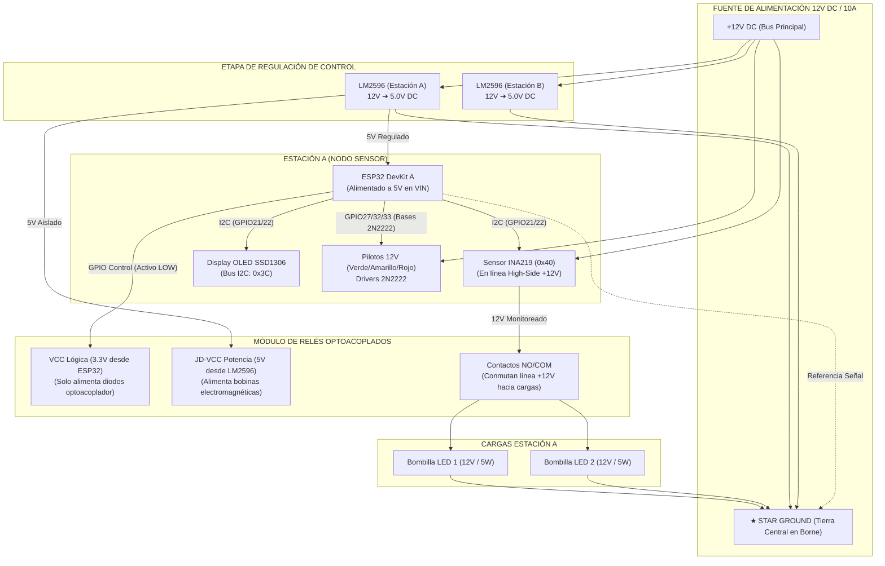
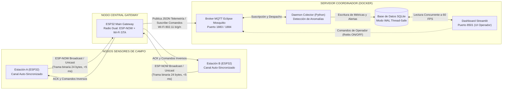
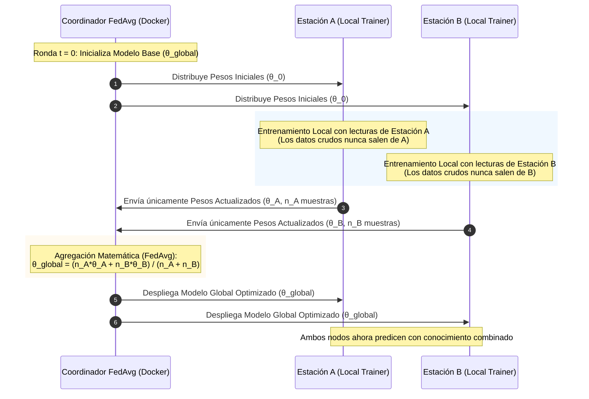
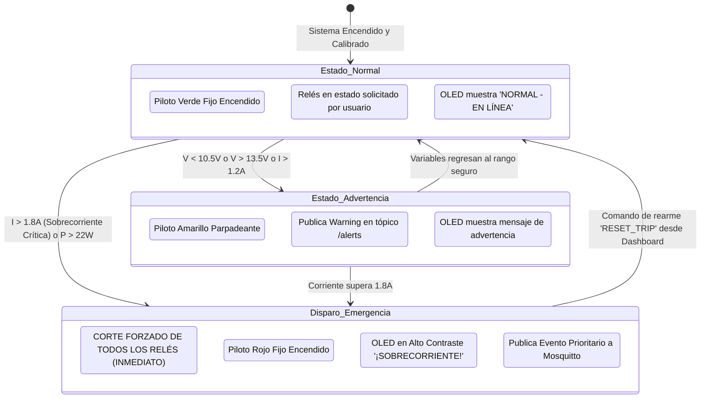

# 📐 ARCEUS GRID — Diagramas Visuales de Arquitectura e Ingeniería

Esta colección de diagramas en formato **Mermaid** modela los subsistemas físicos, eléctricos, de comunicaciones y de Inteligencia Artificial del proyecto. Pueden visualizarse en GitHub, Obsidian, VS Code o exportarse como imágenes para las diapositivas.

---

## 1. Arquitectura Eléctrica y Topología de Potencia (Star Ground + JD-VCC)

Este diagrama ilustra la separación de masas, el aislamiento de relés y la alimentación de los microcontroladores:

---

## 2. Topología de Red Inalámbrica Híbrida (ESP-NOW + MQTT Broker)

Muestra cómo se comunican las estaciones de campo con el servidor sin colapsar el router Wi-Fi:

---

## 3. Flujo del Algoritmo de Aprendizaje Federado (FedAvg)

Ilustra la privacidad de datos: cómo aprenden las estaciones colaborativamente sin enviar sus lecturas crudas:

---

## 4. Máquina de Estados de Seguridad y Protección Activa en el Borde

Muestra la lógica determinista no bloqueante ejecutada en cada ciclo de `loop()` del ESP32:

